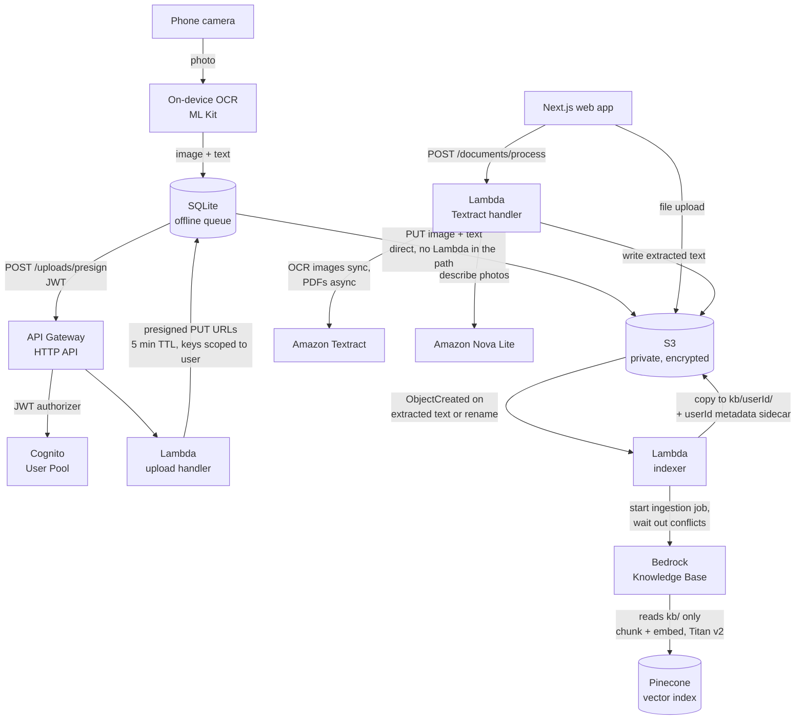
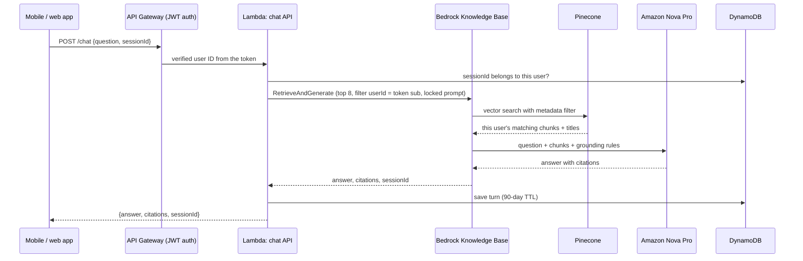

# DocVault: Grounded AI Chat Over Your Own Documents

By **Nicholas Willard**. [GitHub](https://github.com/kwiknick) · [LinkedIn](https://linkedin.com/in/nicholas-willard)

DocVault is a mobile app, a web app, and a serverless AWS backend. Together they turn a pile of paper into a knowledge base you can ask questions in plain English. You scan a document with your phone. The app reads the text on the device, uploads the image and text to private storage, and indexes the text for retrieval. Later you ask "when does my car registration expire?" or "what does my insurance cover for physical therapy?" and get an answer drawn only from your own documents, with the source document cited.

This repo documents the architecture and the engineering decisions. The production source stays private for now, because the system holds personal documents (insurance, medical, financial).

Read **[AI-DESIGN.md](./AI-DESIGN.md)** for the retrieval, grounding, and LLM-reliability approach in detail, and **[How I build with AI](#how-i-build-with-ai)** for how the project gets built.

Building a customer-facing AI chatbot, such as an e-commerce shopping or support assistant? Jump to **[How this maps to a customer-facing AI chatbot](#how-this-maps-to-a-customer-facing-ai-chatbot)**.

---

## What it does

1. **Scan.** Point the phone camera at a document and tap once. Text recognition runs on the device, so the image never goes to a third-party OCR service.
2. **Upload.** The app saves the job to a local queue first, then uploads the image and the extracted text straight to S3 through short-lived presigned URLs. No connection? The job waits in the queue and retries later.
3. **Index.** A new text file in S3 triggers a server-side indexer. It copies the text to an area only the server can write, tags it with the owner's user ID, and starts ingestion into a Bedrock Knowledge Base. The text gets chunked, embedded, and stored in a vector index.
4. **Ask.** The chat screen sends a question to a Lambda function. The function retrieves the most relevant chunks, has the model answer only from those chunks, and returns the answer plus the source documents it used. On the web, each source is a link that opens the original document, so checking an answer takes one click.
5. **Browse.** A list or grid of every document, with a fullscreen viewer, rename, and delete (admins only). Renaming re-indexes the document, so answers cite the new name.

A Next.js web app offers the same scan, chat, and browse features on desktop. A browser has no on-device OCR, so web uploads go through Amazon Textract instead, and photos also get a written description from Nova Lite so a picture with no text in it is still searchable.

---

## Architecture

### Scan, upload, and index

### Ask a question

---

## What this demonstrates

**AI and LLM engineering** (details in [AI-DESIGN.md](./AI-DESIGN.md)):

- **Retrieval-augmented generation (RAG) end to end**: ingestion, chunking, embeddings, vector search, grounded generation, and citations, all on managed AWS services.
- **Grounding over fluency.** The prompt template is locked on the server. The model answers only from retrieved text, cites the source, and returns a fixed "I couldn't find that in your documents" message instead of guessing.
- **Per-user data isolation in a shared vector index.** Only the server writes what gets indexed, and every query filters by the user ID from the verified token. Details in AI-DESIGN.md.
- **A security model that assumes prompt injection will happen.** The model has no tools and nothing secret in its prompt, and retrieved text only reaches the person who uploaded it, so a hijacked answer stays a wrong answer. See [Security model](./AI-DESIGN.md#security-model-limit-what-an-attack-can-reach).
- **Model choices made from evidence, not assumptions.** I started answers on the smallest model, watched it refuse questions that retrieval had answered correctly, proved retrieval was fine with the Retrieve API, and moved answers up one size. Photo descriptions stay on the small model. A free-tier vector store instead of a managed one with a high monthly floor.
- **Multimodal indexing.** Photos get an AI-written description at upload, so "how deep was the creek?" can be answered from a picture with no words in it.
- **Conversation continuity**: Bedrock session IDs for multi-turn context, plus a per-user chat history in DynamoDB that expires on its own.

**AWS services used:**

- **Amazon Bedrock Knowledge Bases**: managed ingestion and `RetrieveAndGenerate`, with fixed-size chunking (500 tokens, 10% overlap) and Titan Text Embeddings v2
- **Amazon Bedrock (Nova Pro and Nova Lite)**: Pro writes cited answers, Lite describes uploaded photos
- **Pinecone**: external vector store behind the Knowledge Base, with its API key held in Secrets Manager
- **Lambda (Python 3.12)**: upload presign, document list, rename, and delete, chat, Textract OCR, and the indexer, each with its own least-privilege IAM role and a shared helpers layer
- **API Gateway (HTTP API) + Cognito**: a JWT authorizer on every route, throttling (tighter on chat, where each call costs a model invocation), an invite-only user pool, SRP sign-in, no client secret on the devices, and an `admin` group that gates delete
- **S3**: a private, encrypted, versioned bucket. Client data lives under `users/{userId}/`, and the indexed copies under `kb/{userId}/`, which only the server writes
- **DynamoDB**: chat history keyed by user, with TTL expiry
- **Amazon Textract**: OCR for web uploads, synchronous for images and asynchronous for PDFs
- **CloudFront + S3**: static hosting for the web app, with origin access control
- **CloudWatch**: a billing alarm as a cost guardrail
- **AWS CDK (Python)**: all of the above as infrastructure as code

**Client engineering:**

- **React Native (Expo, TypeScript)** for iOS and Android, and **Next.js + Tailwind** for the web
- **Offline-first upload queue** in SQLite: every scan persists locally before any network call, with automatic retries (max 3) and a `failed` state
- **Clean layering**: typed service interfaces and DTOs, and screens depend on services, never the other way around
- **Testing**: about 185 Jest unit and component tests, Stryker mutation testing on the service layer, live tests against real AWS run on demand, and pytest + moto for the Lambdas
- **CI with GitHub Actions**: type checks, tests, and web builds on every PR, plus EAS cloud builds for mobile

---

## Engineering highlights

**OCR happens on the phone.** ML Kit reads the text on the device. No per-page OCR bill, no cloud round trip, and the image never goes to a third-party OCR API. The web app has no such option, so it uses Textract, the right tool for that client, not a one-size-fits-all choice.

**The app never holds AWS credentials.** The upload Lambda builds the S3 key from the user ID in the verified token and returns a presigned PUT URL that expires in 5 minutes. The client uploads straight to S3. The Lambda never touches the bytes, so it stays fast and cheap, and the client can never pick where its file lands.

**Offline-first by default.** A scan is saved to a local SQLite queue before the app tries the network. A bad connection doesn't lose a document. It delays it.

**Multi-tenant from day one.** Every S3 path starts with `users/{userId}/`. This cost nothing when the app had one user, and it made adding Cognito accounts a configuration change instead of a data migration.

**Access control is tested, not assumed.** Before releasing the source, I ran a whole-repo authorization review. It found 10 issues, including a cross-tenant leak in retrieval and an endpoint that would OCR anyone's file. I wrote a pytest + moto test for each access rule first (a user can't read, OCR, overwrite, rename, delete, or retrieve another user's documents), watched all 19 fail against the old code, then fixed the code until they passed. The suite is now 42 tests.

**Debug the pipeline in halves.** When chat said "I couldn't find that," I checked each stage on its own: the S3 text, then the ingestion job stats, then a raw `Retrieve` call with the user filter, then the full chat call. Retrieval was right every time, which pointed at the answer model, not the index. The ingestion stats also showed the old setup had been failing on 20+ raw images every run, which confirmed one of the review findings.

---

## How I build with AI

I build DocVault with Claude Code as a pair programmer. The architecture, the security model, and the calls on what ships are mine. The AI writes a lot of the code, and the process is set up so its work gets checked before it reaches users.

- **Written rules the agent must follow.** A `CLAUDE.md` in the repo sets the bar: typecheck after every change, no `any` in TypeScript, no silently swallowed exceptions, update tests with every logic change, keep the Makefile in sync. A personal one adds working habits: plan first for non-trivial work, fix root causes, prove it works before calling it done.
- **Hooks enforce what rules can't.** Small shell hooks reject commits over 200 characters and block writing an em dash into any file. A rule in a prompt is a request. A hook is a guarantee.
- **Tests first for anything security-related.** For the tenant-isolation work, the agent wrote 19 tests that tried to cross user boundaries. I watched them all fail against the old code, then the fixes went in until they passed. Red first proves the test can catch the bug.
- **Independent review before shipping.** A separate review agent reads the full diff before I deploy. On the security batch it found 9 issues, including deleted documents that could still show up in answers and chat sessions that weren't tied to a user. Six were fixed before deploy. The other three were judged minor and logged.
- **Plans and decisions live in the repo.** A task file holds the phased plan, the acceptance criteria, and a short review of each batch. Design decisions get written down with the reason, so the next session (human or agent) doesn't re-argue them.
- **Debugging with evidence.** When chat answers were wrong, we checked each stage of the pipeline on its own before changing anything, and found the problem was the model, not the index. Changing the prompt or the model before that check would have been guessing.

The result is that I move much faster than I would alone, and I can still explain and defend every part of the system.

---

## How this maps to a customer-facing AI chatbot

DocVault answers questions about personal documents, but the hard parts carry over to an e-commerce shopping or support assistant almost one for one.

| E-commerce chatbot need | How DocVault handles the same problem |
|---|---|
| Answer from the real catalog, return policy, and FAQ, never from the model's imagination | RAG over a Bedrock Knowledge Base, with a locked prompt that forbids outside knowledge and a fixed "not found" reply |
| Show customers where an answer came from | Citations on every answer, mapped back to the source document |
| Keep the index fresh as products and policies change | Event-driven ingestion: a new or changed file in S3 triggers re-indexing automatically |
| Never show one customer another customer's orders or data | Per-user metadata filtering on retrieval, with the user ID taken from the verified JWT and never from the request body, plus a session-ownership check |
| Multi-turn conversations ("does it come in blue?") | Bedrock session IDs for context, and chat history in DynamoDB with TTL |
| Keep the cost per conversation low at high volume | The smallest model that passes the tests for each job (Pro for answers, Lite for image descriptions), a free-tier vector store, serverless everywhere, and a billing alarm |
| Web and mobile clients on one backend | One Cognito-authenticated API shared by a React Native app and a Next.js site |
| Untrusted input from the public internet | JWT authorizer on every route, server-built storage keys, least-privilege IAM per Lambda, generic error messages |

**What I'd add for e-commerce,** building on lessons from this project and my [training-tracker](https://github.com/kwiknick/training-tracker-showcase) project:

- **Live facts through tool calls, not the vector index.** Price, stock, and order status change by the minute. They belong in a tool call to the source system at answer time, not in a vector index that might be hours stale. This is the same rule I follow elsewhere: anything that must be exactly right comes from code, not from the model's memory.
- **An evaluation set before launch.** A fixed list of real customer questions with expected answers and expected sources, run on every prompt or model change, to catch regressions in retrieval and grounding.
- **Bedrock Guardrails** for topic limits, PII redaction, and contextual grounding checks, which are already in my cost model as the next tier.
- **Structured metadata on chunks** (category, brand, price band) so retrieval can filter before it ranks, the same mechanism DocVault uses for per-user isolation.
- **Handoff to a human** when the model returns "not found" or the customer asks for one, with the conversation history attached.

---

## Key decisions and tradeoffs

| Decision | Why | Rejected alternative |
|---|---|---|
| Bedrock Knowledge Base, not a hand-built RAG pipeline | Managed chunking, embedding, ingestion, and citations. I spend my time on grounding and access control, not glue code. | LangChain plus a custom ingestion pipeline: more control, more code to own |
| Pinecone free tier as the vector store | $0 at personal scale, and 100K vectors covers years of documents | OpenSearch Serverless: a monthly floor in the hundreds of dollars before a single query |
| Nova Pro for answers, Nova Lite for photo descriptions | Lite refused several correct matches in testing, Pro answered all of them. Lite describes photos well. Each job gets the smallest model that passes. | Lite everywhere: cheaper, but it missed answers retrieval had found. A large model everywhere: more cost for no gain on descriptions |
| Copy indexed text to a server-only `kb/` prefix | Clients can't forge the `userId` metadata the chat filters on | Indexing `users/` directly: clients control what gets indexed, and raw images failed ingestion |
| One Knowledge Base, no topic routing | One user's documents are distinct enough that one index retrieves well. A router adds a classifier that can misroute. | One index per domain (insurance, medical, ...): more sync jobs, more cost, more failure modes |
| On-device OCR on mobile | Free, private, works offline | Server OCR for everything: per-page cost and an extra network trip |
| Presigned URLs | No credentials on the device, no Lambda in the upload path | Uploading through Lambda: slower, costs more, payload size limits |
| Cognito JWT on every route | User ID comes from a verified token, so access control never trusts the request body | API keys: one shared secret, no per-user identity |

---

## Cost

Designed to run for one person at roughly **$2 to $5 per month**. Knowledge Base ingestion and S3 storage make up most of it. Answer generation on Nova Pro costs well under a cent per question, and a photo description on Nova Lite costs a tiny fraction of a cent. Lambda, API Gateway, and DynamoDB stay within free-tier levels at this scale. Pinecone's free tier covers the vector index. A CloudWatch billing alarm fires at $10, so a mistake can't run up a surprise bill.

---

## Status

DocVault runs live on Android and the web: scan, upload, photo descriptions, index, chat with citations, browse, rename, and delete. Tenant isolation is done: the server-side indexer, per-user retrieval filtering, session ownership checks, and least-privilege IAM are deployed, and the 19 access-control tests that failed before the fix now pass. The source is being prepared for public release (documentation and a history scrub of infrastructure IDs). Still open: a live two-account isolation check and neutral file names on the mobile client.

---

*This is a companion showcase repo. The production source, documents, and infrastructure configuration stay in a private repository for now. This repo documents the architecture and engineering decisions only. No application code, credentials, or personal data live here.*

---

**Nicholas Willard**. [github.com/kwiknick](https://github.com/kwiknick) · [linkedin.com/in/nicholas-willard](https://linkedin.com/in/nicholas-willard)
